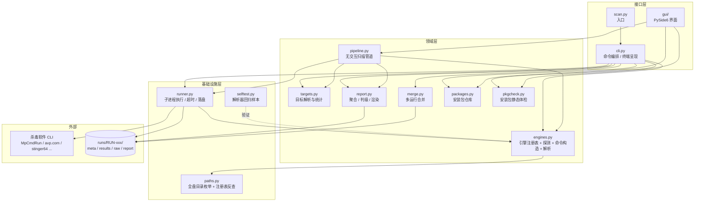
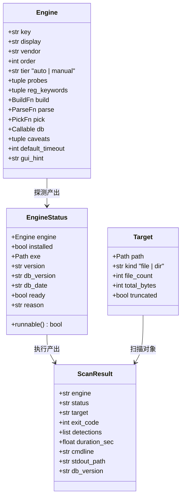
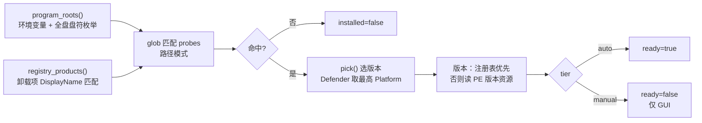
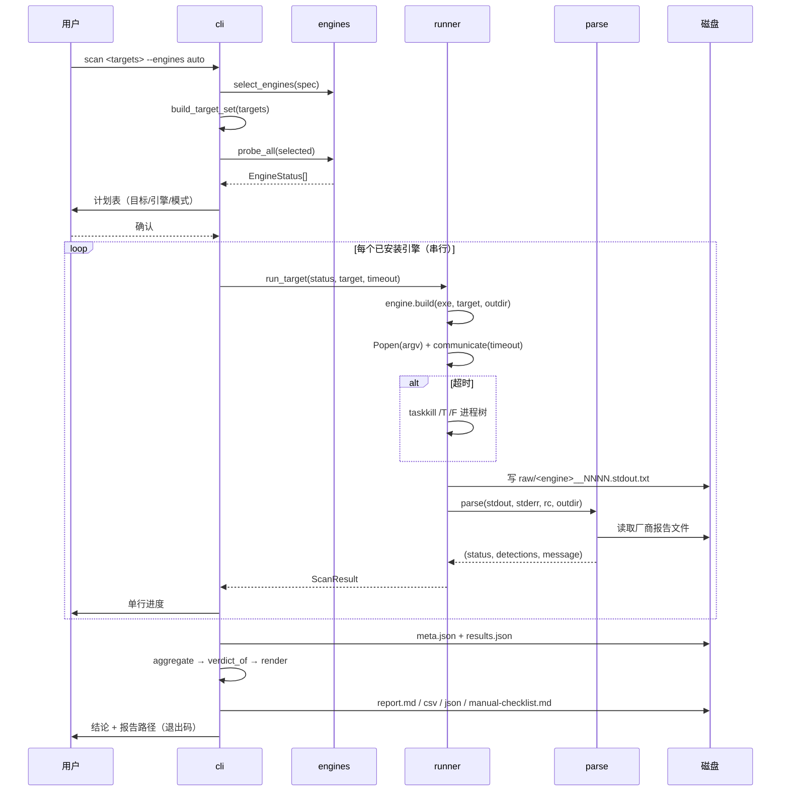
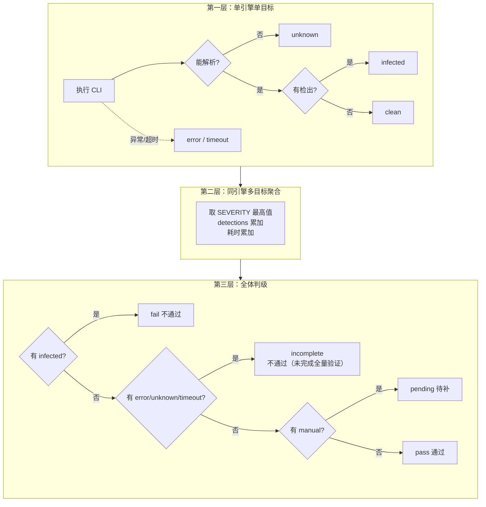
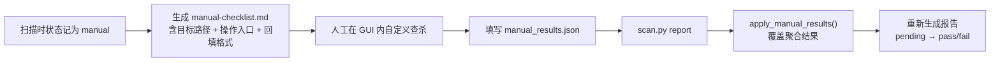
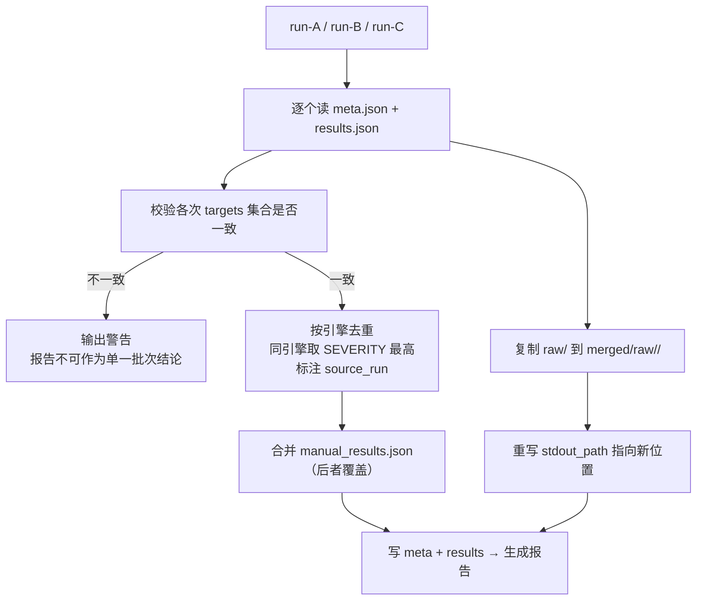

# avscan 架构设计文档

> 多引擎批量扫毒编排工具 · 版本 0.1.0 · 更新于 2026-10-29
>
> 配套文档：[README.md](README.md)（使用说明）、[FEATURES.md](FEATURES.md)（功能清单）

---

## 一、定位

avscan 不生产杀毒引擎，它解决的是**编排与取证**问题：

把一批异构杀毒软件（常驻型、便携型、纯 GUI 型）统一成一次可重复执行的扫描任务，并把每个引擎的输出收敛成**同一套结论语义 + 可归档的证据链**。

核心使用场景：软件发布前，对安装包与安装目录做多厂商交叉验证，产出能交给审核方的扫毒报告。

---

## 二、设计原则

这四条决定了几乎所有实现细节，改动代码前请先确认没有违反。

| # | 原则 | 具体表现 |
|---|---|---|
| 1 | **诚实优先于完整** | 读不懂输出就返回 `unknown`，永远不默认 `clean`。被跳过、超时、解析失败的一律不计入「无毒」 |
| 2 | **只检测，不处置** | 刻意不传删除/隔离参数（如 Defender 的 `-DisableRemediation`）。避免误删待发布的安装包 |
| 3 | **证据可追溯** | 每个引擎每次执行的 stdout/stderr 原样落盘，报告里引用文件名，任何结论都能回溯到原始记录 |
| 4 | **零第三方依赖** | 仅用 Python 标准库。工具本身要能在任意一台干净机器上立刻跑起来 |

另有一条工程取舍：

> **串行而非并行**。多个杀软同时扫同一批文件会互相抢 IO，部分引擎存在全局锁或授权互斥，并发反而更慢且结果不稳定。

---

## 三、分层架构



依赖方向严格单向：`cli → 领域层 → 基础设施层`，基础设施层不反向依赖命令层。

---

## 四、模块职责

| 文件 | 行数 | 职责 | 关键符号 |
|---|---:|---|---|
| `scan.py` | 21 | 入口，注入 sys.path 后转交 cli | `main()` |
| `avscan/cli.py` | 421 | 5 个子命令编排、终端表格渲染、运行目录创建、退出码 | `cmd_detect` `cmd_scan` `cmd_report` `cmd_merge` `cmd_selftest` |
| `avscan/engines.py` | 612 | 引擎注册表；可执行文件探测；argv 构造；各厂商输出解析 | `Engine` `EngineStatus` `ENGINES` `probe_all` `select_engines` |
| `avscan/targets.py` | 170 | 目标解析（文件/目录/逐文件）、高危扩展名过滤、递归统计 | `Target` `TargetSet` `build_target_set` `RISK_EXTS` |
| `avscan/runner.py` | 228 | 子进程执行、超时与进程树清理、多编码解码、原始输出落盘 | `ScanResult` `run_target` `run_engine` |
| `avscan/report.py` | 380 | 结果聚合、严重度判级、Markdown/CSV/JSON 渲染、核对单、人工回填合并 | `aggregate` `verdict_of` `render_*` `apply_manual_results` |
| `avscan/merge.py` | 127 | 合并多次运行（分次装/卸杀软场景），日志路径重写 | `merge_runs` |
| `avscan/selftest.py` | 215 | 13 个构造样本，回归验证解析器不误判 | `CASES` `run` |
| `avscan/paths.py` | 133 | 全盘 Program Files 枚举、卸载注册表反查 | `program_roots` `registry_products` |
| `avscan/pipeline.py` | 200 | 无交互扫描管道：探测 → 执行 → 写报告，CLI 与 GUI 共用 | `build_plan` `run_scan` `ScanPlan` `ScanOutcome` |
| `avscan/pkgcheck.py` | 380 | 安装包静态体检：PE 解析、安装框架识别、加壳判定 | `parse_pe` `inspect_paths` |
| `avscan/packages.py` | 290 | 安装包仓库：清单、一键安装、手动入口、完整性校验 | `Pkg` `install_package` `open_package` |
| `gui/` | 1400 | PySide6 界面：主题、组件、三个页面、后台线程 | `MainWindow` `ScanPage` `PackagesPage` |

---

## 五、核心数据模型



### 关键约定

- **`Engine` 是冻结 dataclass**：注册表在导入期构建完成，运行期不可变，避免状态污染。
- **`ScanResult` 是唯一跨模块契约**：runner 产出、report 消费、merge 合并、JSON 落盘，都是它。
- **`EngineStatus.runnable`** 是「能否自动跑」的单一判据：`tier == auto && installed && exe 存在`。

---

## 六、关键流程

### 6.1 引擎探测（detect）



设计要点：**国产安全软件普遍装在非系统盘**（本机火绒在 `D:\Program Files\Huorong`），所以不能只查 `%ProgramFiles%`。`program_roots()` 会遍历所有存在盘符的 `Program Files`、`Program Files (x86)`、`Programs`，并追加项目内 `tools/` 目录以识别便携扫描器。

### 6.2 扫描执行（scan）



### 6.3 结论判定状态机

三层收敛，**每一层都只允许「变得更严重」，不允许把严重降级**。



严重度权重（`report.SEVERITY`）：

```
infected 6 > error 5 > unknown 4 > timeout 3 > manual 2 > clean 1 > skipped 0
```

### 6.4 人工回填闭环

三款国产杀软没有 CLI，走「生成核对单 → 人工扫描 → 回填 → 重算」的闭环：



`manual_results.json` 结构：

```json
{ "huorong": { "status": "clean", "db_version": "2026.10.29.1", "db_date": "2026-10-29", "note": "" } }
```

### 6.5 多运行合并（merge）

现实约束：9 款消费级杀软不能长期共存。实际做法是「装一款 → 扫 → 卸 → 换下一款」，结果散落在多个 run 目录。



---

## 七、如何新增一个引擎

以接入 KVRT 为例，五步：

**第 1 步 · 写命令构造函数**

```python
def _build_kvrt(exe: Path, target: Path, outdir: Path) -> list[str]:
    return [str(exe), f"-custom:{target}", "-accepteula", "-dontencrypt"]
```

**第 2 步 · 写输出解析器**

签名固定为 `(stdout, stderr, rc, outdir) -> (status, detections, message)`。
必须覆盖三种情形：**明确无检出 → clean**、**明确有检出 → infected**、**读不懂 → unknown**。

```python
def _parse_kvrt(stdout, stderr, rc, outdir):
    text = _text_of(stdout, stderr) + _read_report(outdir / "kvrt.log")
    if re.search(r"detected\s*[:：]\s*(.+)", text, re.I):
        return INFECTED, [...], "检出"
    if re.search(r"no\s+threats?", text, re.I):
        return CLEAN, [], "未发现威胁"
    return UNKNOWN, [], f"退出码 {rc}，无法判定"
```

**第 3 步 · 注册到 `ENGINES`**

```python
Engine(
    key="kvrt",
    display="Kaspersky Virus Removal Tool",
    vendor="Kaspersky",
    order=11,
    tier="auto",                       # 无 CLI 则填 manual
    probes=("kvrt/KVRT.exe",),         # 相对 tools/ 或 Program Files
    reg_keywords=("Kaspersky",),
    build=_build_kvrt,
    parse=_parse_kvrt,
    caveats=("需管理员权限",),
    default_timeout=3600,
)
```

**第 4 步 · 加自检样本**

`selftest.py` 的 `CASES` 至少补三条：clean / infected / 不可解析必须 unknown。

**第 5 步 · 三步校准**

```bash
python scan.py detect                      # 确认探测到
python scan.py scan <目标> --engines kvrt --dry-run   # 确认命令拼装正确
python scan.py scan <目标> --engines kvrt --yes       # 实跑，核对日志与判定
```

> ⚠️ 参数没验证过就注册，最坏结果是「悄悄扫了个空目录然后返回 clean」。因此第 4 步的
> 「不可解析必须判 unknown」这条样本是强制项，不是可选项。

---

## 八、必须守住的不变量

改动代码时，以下任意一条被破坏都视为严重缺陷：

| # | 不变量 | 破坏后果 |
|---|---|---|
| 1 | 解析不出结论 → `unknown`，绝不 `clean` | 假阴性，出假报告 |
| 2 | 超时 → `timeout`，不计入 `clean` | 大包扫不完却报无毒 |
| 3 | 引擎未安装 / 未执行 → `skipped` / `manual` | 把「没扫」当成「扫过」 |
| 4 | 默认不传任何处置参数 | 误删/误隔离待发布文件 |
| 5 | 原始 stdout/stderr 必须落盘 | 结论不可复核 |
| 6 | 结论非 `pass` 时进程退出码非 0 | CI 接入后失效 |
| 7 | 同引擎多结果聚合只能取更严重 | 后一次干净覆盖前一次检出 |

---

## 九、目录结构

```
scan/
├── scan.py                     入口
├── README.md                   使用说明
├── ARCHITECTURE.md             本文档
├── FEATURES.md                 功能清单
├── avscan/
│   ├── __init__.py             版本号
│   ├── cli.py                  命令编排
│   ├── engines.py              引擎注册表（核心，669 行）
│   ├── targets.py              目标解析
│   ├── runner.py               执行器
│   ├── report.py               报告渲染
│   ├── merge.py                多运行合并
│   ├── selftest.py             解析器回归样本
│   └── paths.py                路径与注册表探测
├── tools/                      便携扫描器（detect 自动识别）
│   ├── emsisoft/               保留未接入（GUI 版可手动使用）
│   ├── kvrt/KVRT.exe
│   ├── msert/msert.exe
│   └── stinger/stinger64.exe
└── runs/
    └── RUN-YYYYMMDD-HHMMSS-<label>/
        ├── meta.json           运行元数据（目标/环境/时间）
        ├── results.json        全量 ScanResult
        ├── manual_results.json 人工回填（人工创建）
        ├── raw/                各引擎原始输出
        ├── report.md / .csv / .json
        └── manual-checklist.md
```

---

## 十、已知技术债

| 项 | 影响 | 计划 |
|---|---|---|
| 5 个引擎的解析器仅靠构造样本验证 | 真实输出格式可能不一致 | 装真实产品后 `--dry-run` 校准 |
| 无断点续扫 | 大目录超时后需整轮重跑 | 按 target 粒度缓存 ScanResult |
| 无增量扫描 | 每次全量 | 基于文件 mtime/size 做变更集 |
| 病毒库更新依赖各引擎自身 | EEK 需 GUI 手动更新 | 增加 `update` 子命令统一触发 |
| 报告无 HTML 版 | 不便直接分发 | 复用 md → html 转换 |
| 无并发 | 多引擎串行耗时线性累加 | 设计上保持串行，仅对同引擎多目标做受控并发 |
